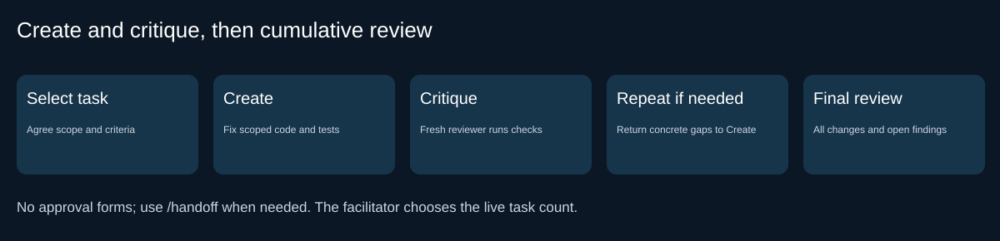

# Secure Software Lab: Understand, Prioritize, Create and Critique

Your team has inherited a synthetic legacy Java service. Before extending it, understand what it
does, investigate its weaknesses and make changes you can defend with evidence. A green build is
only the beginning. Copilot reads and writes; you decide whether its claims and fixes are supported.

## Your route

| Clock | Stage | Outcome |
| --- | --- | --- |
| 0 to 10 | 0 Setup and demonstration | Tools and baseline ready |
| 10 to 22 | 1A Map | Source-grounded architecture and attack surface |
| 22 to 35 | 1B Investigate | Findings, severity and uncertainty |
| 35 to 50 | 2 Threat model | STRIDE, blast radius and five priorities |
| 50 to 70 | 3 Create and critique | Selected tasks independently verified one at a time |
| 70 to 85 | 4 Final review | All changes compared with original findings |
| 85 to 90 | 5 Debrief | Transfer and next actions |

The facilitator normally chooses one or two tasks for live implementation. Continue through more
priorities when time permits or after the session. The workflow has no implementation count limit.
Review and debrief are never cut. The facilitator can shorten discussion of lower-ranked findings
and repeated scoring explanations to protect implementation time, or end the live scope explicitly.
Five completed fixes are not promised within 90 minutes.

## How to drive each stage

1. Start the stage in a new Copilot chat. Select the named agent in the picker.
2. Type `/` and select the existing skill. The skill reads its input files by path; you do not
   paste an operating prompt, attach the whole repository or repeat the previous stage's summary.
3. Inspect the generated report and relevant source/run evidence. Confirm the human gate only
   when supported; record pass, fail or pending honestly.
4. At stage END, switch to **Hand-off Recorder in that same chat** and select `/hand-off`.
   Check the saved `outputs/handoff.md` section, then start the next stage in a fresh chat.

Role and skill selection are separate. Inspect effective tools and Source Control, including new
files. A scope instruction is not a sandbox; a fresh chat does not guarantee independent judgment.
If a skill or role is missing, call the facilitator. Use only the rehearsed fallback in
[compatibility](docs/COMPATIBILITY.md). No new CLI is required.

## 0. Check your setup (10 minutes)

Complete [compatibility](docs/COMPATIBILITY.md) before the session and read [the scenario](docs/SCENARIO.md).

- Confirm seven visible agents: Codebase Mapper, Security Vulnerability Hunter, STRIDE Threat
  Modeler, Secure Remediation Engineer, Secure Code Reviewer, Hand-off Recorder and OWASP Security
  Expert. Package Explorer is a hidden helper.
- Confirm seven skills: `/map-codebase`, `/find-vulnerabilities`, `/generate-threat-model`,
  `/fix-vulnerability`, `/review-security-fix`, `/hand-off` and optional `/security-review`.
- Run `mvn clean test` in the terminal. It must build successfully. Some shipped security checks
  are intentionally skipped until explicitly enabled. Inspect the actual summary rather than
  treating green as proof of security. Exact release counts are in [verification](docs/VERIFICATION.md).
- Observe the facilitator demonstrate role selection, skill invocation, a report gate and separate
  handoff. Agents create report files from their templates when needed; you need not copy forms.

## 1A. Map the codebase (12 minutes)

**Question:** what have we inherited, and where does untrusted input enter?

**Input:** actual source/configuration and the scenario.

1. New chat, **Codebase Mapper**, `/map-codebase`.
2. The mapper discovers packages and asks Package Explorer for compact per-package summaries where
   supported. With no subagents it reads sequentially and records that route.
3. Open `outputs/codebase-map.md`. Inspect representative entry points and call edges in source.

**Gate:** actual packages are indexed, externally controlled inputs and resources are named, and
source supports every implemented diagram edge. Mark unknowns. A standalone helper is not an HTTP
endpoint merely because it has a public method. No completed architecture is supplied.

Set the report gate, then **Hand-off Recorder**, `/hand-off` in this chat.

## 1B. Investigate (13 minutes)

**Question:** which weaknesses are supported, and what evidence is still missing?

**Input:** map and actual code paths.

1. New chat, **Security Vulnerability Hunter**, `/find-vulnerabilities`.
2. Read `outputs/findings.md`. Inspect the top findings' input-to-sink paths and preconditions.
3. Check severity and coverage, merge duplicate root causes, and reject a plausible false positive
   with a reason. Different titles or finding counts are expected; evidence is the assessment.

**Gate:** findings cite current source, distinguish confirmed paths from needs-evidence claims, and
retain uncertainty. Preserve this accepted discovery record; later resolution belongs in task/review
artifacts rather than rewriting the original finding away.

Set the report gate, then **Hand-off Recorder**, `/hand-off`.

## 2. Threat model and prioritize (15 minutes)

**Question:** which threats deserve attention first, and why?

**Input:** architecture and ALL Stage 1 findings.

1. New chat, **STRIDE Threat Modeler**, `/generate-threat-model`.
2. Read `outputs/threat-model.md`. Check STRIDE categories, severity, existing controls, impact,
   likelihood and the source/assumptions behind each threat.
3. For the top five, inspect blast radius: who can exploit it, what they reach, the action,
   repeatability and whether it would be noticed. Confirm the priority order.
4. Check that each selected threat has a remediation objective, scope and positive/negative
   acceptance criteria. There is no prescribed list of vulnerability types. Do not invent a fifth
   threat merely to fill a quota if evidence is incomplete; resolve the gap with the facilitator.

**Gate:** five evidence-ranked priorities trace to findings and boundaries. Additional findings
remain visible. Priority is a decision informed by evidence, not proof that all five are Critical.
No mitigation is labelled implemented before code and verification exist.

Set the report gate, then **Hand-off Recorder**, `/hand-off`.

## 3. Create, critique and verify (20 minutes, extend only within facilitator allocation)

**Question:** does this change remove the selected weakness while preserving legitimate behavior?

**Input:** selected priorities, original findings, actual code and agreed acceptance criteria.

1. New implementation chat, **Secure Remediation Engineer**, `/fix-vulnerability`.
   The skill creates `outputs/tasks.md` and `outputs/change-plan.md` from templates, selecting
   the next agreed priority. You decide the live scope; one, two or more tasks are supported.
2. Inspect the proposed root cause, source/helpers/test scope, preserved behavior and checks.
   Observe actual pre-fix behavior with a relevant negative check. Agree the plan before edits.
3. **Create:** the agent records Cycle before editing, implements the fix and focused tests,
   executes task checks and ordinary/previous-task regression, and records actual evidence.
4. **Critique:** open a fresh chat, select **Secure Code Reviewer**, then invoke
   `/review-security-fix task <selected-ID>` using the actual task ID. The reviewer reads artifacts,
   inspects the real diff and untracked files, reruns checks independently and challenges the fix
   with bounded local adversarial cases. Read `outputs/task-reviews.md` and the ledger status.
5. If CHANGES REQUIRED, return to the preserved implementation chat and invoke
   `/fix-vulnerability correction`. Address the specific critique, then review again in a fresh
   chat. At most **three complete Create/critique cycles per task**, including the initial attempt.
   Stop earlier when accepted. NEEDS EVIDENCE blocks advancement until supplied.
6. **Advance only after verified.** Return to implementation and invoke `/fix-vulnerability` for
   the next task. Keep earlier task checks in regression. Third-cycle failure marks unresolved
   and pauses for the facilitator; do not silently skip or claim a pass.
7. At the time checkpoint, the facilitator ends live scope and explicitly defers the remaining
   tasks for continuation. Preserve any unresolved details. Check task state and the Stage 3 gate,
   then select **Hand-off Recorder in the implementation chat**, `/hand-off`.

**Evidence rules:** tests come from the chosen task, not a fixed suite/count. Existing opt-in checks
can support relevant tasks; skipped checks for unselected weaknesses remain unverified. New task
checks normally join ordinary regression. Do not weaken tests, replace a missing control with a
fabricated identity, change dependencies or contact real external targets. Record run failures,
skips, source identity and full output. A compilation error is not an expected security failure.

**Gate:** every completed task has independent acceptance, legitimate-behavior and regression evidence.
The ledger retains all other task states and cycle histories. Creation never self-certifies a fix.
A participant approves scope and real decisions; agents maintain artifacts without repeated forms.

## 4. Final cumulative review (15 minutes, never cut)

**Question:** what changed, what is now supported, and what remains open?

**Input:** original findings, selected priorities, cumulative code/test changes, ledger and task critiques.

1. New chat, **Secure Code Reviewer**, `/review-security-fix final`.
2. Inspect `outputs/review.md`. The reviewer compares every original finding with current status,
   checks all actual changes and interactions, and runs completed-task checks plus regression.
3. Inspect ACCEPTED, CHANGES REQUIRED or NEEDS EVIDENCE against the actual evidence. ACCEPTED covers
   verified completed scope only. Deferred, partial and unresolved work must remain visible.
4. A regression returns to the affected task's remaining cycle budget; the reviewer cannot reset
   the budget or edit application code. If time/budget is exhausted, preserve the failing verdict.

**Gate:** completed scope has matching evidence; original findings have current dispositions; no
skipped, deferred or unresolved work is misrepresented as fixed. Inspect residual risks and limits.

Set the final gate, then **Hand-off Recorder**, `/hand-off` in the review chat.

## 5. Debrief (5 minutes, never cut)

1. Which model claim changed after you checked the source or ran a test?
2. Which critique exposed an incomplete fix or broken legitimate behavior?
3. Which prioritized work remains, and what would be needed to finish it?

Take away the map, findings, threat model, task ledger, plan, per-task critiques, final review and
handoff. On your own code, separate evidence from confidence, constrain tool authority, protect
sensitive context and inspect changes before accepting generated output. These are useful AI-security
habits, not a demonstration that prompt injection or all service risks are eliminated.

## If you get stuck

| Symptom | Action |
| --- | --- |
| Agent or skill missing | Stop for facilitator; qualify the existing-procedure fallback |
| Mapper has no subagents | Sequential reading is supported; record the route and adjust live scope |
| Agent asks for copied logs | Point it to the actual report/evidence path or missing run |
| New task still sees old handoff | Read current ledger/reviews; handoff happens at stage end |
| A task needs a correction | Resume its existing cycle history; never reset across chats |
| Third cycle fails | Mark unresolved and pause for facilitator |
| Test count changes | Inspect discovered classes and task scope; there is no fixed passing total |
| Dependencies or application startup fail | Use the approved support route; do not bypass restrictions |

Optional `mvn -Dtest=OutputsCheck test` checks report form and ledger consistency, not security truth.
Reports not started are skipped. Existing incomplete reports fail rather than proving completion.

**IntelliJ/manual route:** use the rehearsed attachment of the existing agent instructions and phase
SKILL.md, then the one-line request `Follow the attached procedure.` Match roles/tools, save outputs
and run Maven yourself where needed. If execution or separate review context is unavailable, use
facilitator-led review and label the gap. Do not claim native parity or install an extra CLI.

Copyright InRhythm / Arula. Training material using synthetic data.
