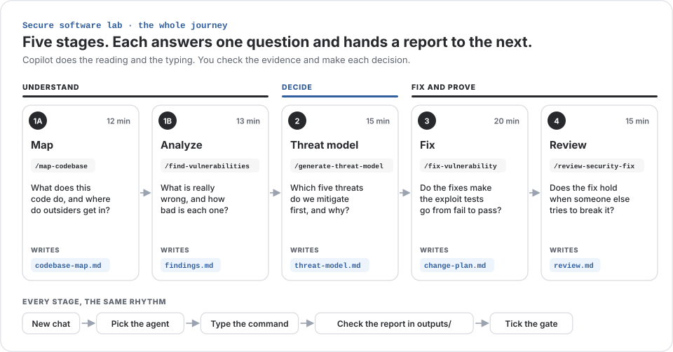

# Secure Software Lab: Understand, Prioritize, Create and Critique

Your team has inherited a synthetic legacy Java service. Before extending it, understand what it
does, investigate its weaknesses and make changes you can defend with evidence. A green build is
only the beginning. Copilot reads and writes; you decide whether its claims and fixes are supported.

## Your route

| Clock | Stage | Outcome |
| --- | --- | --- |
| 0 to 5 | 0 Setup and demonstration | Tools and baseline ready |
| 5 to 10 | 1A Map | Source-grounded architecture and attack surface |
| 10 to 18 | 1B Investigate | Findings, severity and uncertainty |
| 18 to 28 | 2 Threat model | STRIDE, blast radius and five priorities |
| 28 to 50 | 3 Create and critique | Requested fix, tests and independent critique |
| 50 to 57 | 4 Final review | Actual completed changes and remaining work |
| 57 to 60 | 5 Debrief | Transfer and next actions |

This is a 60-minute hands-on allocation, subject to the timed rehearsal. The facilitator chooses
one main implementation assignment, adding another only if time permits. All five cards remain
available for follow-up. Do not promise five completed fixes. Shorten discussion or live task count
rather than removing tests or final review.



## How to drive each stage

1. Start each stage in a new Copilot **Local** chat. Select the named agent, then invoke the skill shown below. Each skill identifies its corresponding agent and bundles its report format.
2. Inspect the generated report and source/test evidence. Reports have no approval fields, and no stage waits for a pass/fail decision or handoff.
3. Select **Hand-off Recorder** and use `/hand-off` in the working chat only when you want a continuation snapshot. Start the next stage directly when ready.

Inspect effective tools and Source Control, including new files. Scope instructions are not a sandbox;
a fresh chat does not guarantee independent judgment. Skills run in the selected agent context;
selecting a skill does not automatically change the agent.

If a skill or role is missing, call the facilitator. Use only the rehearsed fallback in
[compatibility](docs/COMPATIBILITY.md). No new CLI is required.

## 0. Check your setup (5 minutes)

Complete [compatibility](docs/COMPATIBILITY.md) before the session and read [the scenario](docs/SCENARIO.md).

- Confirm seven visible agents: Codebase Mapper, Security Vulnerability Hunter, STRIDE Threat
  Modeler, Secure Remediation Engineer, Secure Code Reviewer, Hand-off Recorder and OWASP Security
  Expert.
- Confirm seven skills: `/map-codebase`, `/find-vulnerabilities`, `/generate-threat-model`,
  `/fix-vulnerability`, `/review-security-fix`, `/hand-off` and optional `/security-review`.
- Run `mvn clean test` in the terminal. It must build successfully. Some shipped security checks
  are intentionally skipped until explicitly enabled. Inspect the actual summary rather than
  treating green as proof of security. Exact release counts are in [verification](docs/VERIFICATION.md).
- Observe the facilitator demonstrate agent selection, skill invocation and optional
  handoff. Agents create report files from their templates when needed; you need not copy forms.

## 1A. Map the codebase (5 minutes)

**Question:** what have we inherited, and where does untrusted input enter?

**Input:** actual source/configuration and the scenario.

1. New Local chat, select **Codebase Mapper**, then `/map-codebase`.
2. The single mapper inventories packages and reads source plus configuration directly. It retains
   citations while reading, checks actual call edges and writes the map without delegation.
3. Open `outputs/codebase-map.md`. Inspect representative entry points and call edges in source.

**What to inspect:** actual packages are indexed, externally controlled inputs and resources are named, and
source supports every implemented diagram edge. Mark unknowns. A standalone helper is not an HTTP
endpoint merely because it has a public method. No completed architecture is supplied.

Continue to the next stage; `/hand-off` is optional.

## 1B. Investigate (8 minutes)

**Question:** which weaknesses are supported, and what evidence is still missing?

**Input:** available map, all application classes and relevant configuration. Inspect standalone components too; assess code defects separately from proven external reachability.

1. New Local chat, select **Security Vulnerability Hunter**, then `/find-vulnerabilities`.
2. Read `outputs/findings.md`. Inspect the top findings' input-to-sink paths and preconditions.
3. Check severity and coverage, merge duplicate root causes, and reject a plausible false positive
   with a reason. Different titles or finding counts are expected; evidence is the assessment.

**What to inspect:** findings cite current source and cover all classes/configuration. Code assessment, caller
reachability and actual verification are separate, with uncertainty retained. Preserve this original discovery record; later resolution belongs in task/review
artifacts rather than rewriting the original finding away.

Continue to the next stage; `/hand-off` is optional.

## 2. Threat model and prioritize (10 minutes)

**Question:** which threats deserve attention first, and why?

**Input:** architecture and available Stage 1 findings. Include supported component risks while preserving caller/exposure uncertainty.

1. New Local chat, select **STRIDE Threat Modeler**, then `/generate-threat-model`.
2. Read `outputs/threat-model.md`. Check STRIDE categories, severity, existing controls, impact,
   likelihood and the source/assumptions behind each threat.
3. Inspect scenario-specific account/identifier prerequisites and the score rationale. If a threat
   groups different paths, check which scenario drives its ranking. For the top five, inspect blast radius: who can exploit it, what they reach, the action,
   repeatability and whether it would be noticed. Confirm the priority order.
4. Check that each selected threat has a remediation objective, scope and positive/negative
   acceptance criteria. Independent controls may need bounded subtasks; completing one must not close
   the parent threat while other controls remain open. There is no prescribed list of vulnerability types. Do not invent a fifth
   threat merely to fill a quota if evidence is incomplete; resolve the gap with the facilitator.

**What to inspect:** five evidence-ranked priorities trace to findings and boundaries. Additional findings
remain visible. Priority is a decision informed by evidence, not proof that all five are Critical.
No mitigation is labelled implemented before code and verification exist.

Continue to the next stage; `/hand-off` is optional.

## 3. Secure Implementation (22 minutes; facilitator selects tasks)

Use the tasks below, as in the original lab. Connect your chosen task to the findings and threat
model from Stages 1 and 2. The facilitator decides which tasks to complete live; the rest are follow-up.

For each task:

1. Select **Secure Remediation Engineer** and send the implementation prompt with `/fix-vulnerability`. The agent explains its approach, fixes the code and runs tests; no separate plan approval is required.
2. In a fresh chat, select **Secure Code Reviewer** and send the review prompt with `/review-security-fix`.
3. If the reviewer finds a gap, return to the implementation chat, ask it to address the review findings,
   then review again. Stop when accepted; ask the facilitator for help after three unsuccessful cycles.
4. Verify the current task before moving to the next. The agents report actual test results; no task ledger or plan file is required.

### Task 1: Secure Authentication

**Implement:**

```text
/fix-vulnerability

Refactor src/main/java/com/securelabs/vulnerable/auth/AuthController.java to:
1. Replace MD5 with BCryptPasswordEncoder, cost factor 12. Update registration and synthetic seed users consistently.
2. Lock an account after 5 failed attempts for 30 minutes. Make time controllable in tests.
3. Secure session expiry, rotation and invalidation using trusted identity.
4. Remove passwords, password hashes and session tokens from unnecessary logs and responses.
5. Use generic authentication errors to avoid revealing whether an account exists.
6. Set HttpOnly, Secure and SameSite attributes on session cookies.

Briefly explain your approach, then make the changes. Add tests for valid login, rejected credentials, lockout and expiry, session behavior and sensitive-data protection. Use existing dependencies.
```

**Verify your fix:** select **Secure Code Reviewer** in a fresh chat and ask:

```text
/review-security-fix

Review my authentication changes in AuthController.java and any supporting files.
Check BCrypt, lockout timing, session controls, cookie attributes and generic errors.
Run the relevant security and regression tests. Confirm legitimate login still works and credentials are not exposed.
Start with PASS, PARTIALLY FIXED, FAIL or NOT VERIFIED and a one-sentence reason. Then give actual test counts and required corrections.
```

### Task 2: Secure Payment Processing

**Implement:**

```text
/fix-vulnerability

Refactor src/main/java/com/securelabs/vulnerable/api/PaymentHandler.java to:
1. Validate positive amounts up to $1M with at most 2 decimal places, using decimal-safe handling.
2. Allow only USD, EUR and GBP.
3. Verify trusted caller identity and transaction ownership before refunds. Reject excessive or repeated refunds.
4. Remove card numbers and CVVs from logs and unnecessary responses or storage.
5. Verify webhook HMAC signatures over the specified raw payload, with timestamp validation and duplicate-event handling.

Briefly explain your approach, then make the changes. Add local tests for legitimate payment/refund/webhook behavior and rejected inputs, wrong owners, invalid signatures and stale or repeated events. No real payment service is required.
```

**Verify your fix:** select **Secure Code Reviewer** in a fresh chat and ask:

```text
/review-security-fix

Review my payment changes in PaymentHandler.java and any supporting files.
Check amount/currency validation, refund ownership and repeatability, sensitive-data protection and webhook authenticity.
Run the relevant security and regression tests. Verify both permitted operations and rejected attacks without real payment calls.
Start with PASS, PARTIALLY FIXED, FAIL or NOT VERIFIED and a one-sentence reason. Then give actual test counts and required corrections.
```

### Task 3: Fix SQL Injection

**Implement:**

```text
/fix-vulnerability

Refactor src/main/java/com/securelabs/vulnerable/data/UserRepository.java to:
1. Bind values with PreparedStatement in executed queries and updates.
2. Allow-list field and sort identifiers in searchUsers, findByQuery and related methods.
3. Define and preserve the intended LIKE search behavior.
4. Remove caller-controlled shell execution from exportUsers; agree a safe supported operation or rejection policy.
5. Prevent avatar paths from escaping the intended directory.

Briefly explain your approach, then make the changes. Use the existing H2 fixture to test legitimate queries and hostile values/identifiers. Add local tests for export and avatar boundaries. Preserve existing assertions.
```

**Verify your fix:** select **Secure Code Reviewer** in a fresh chat and ask:

```text
/review-security-fix

Review my repository changes in UserRepository.java and any supporting files.
Confirm query values are parameterized, identifiers are allow-listed, export inputs cannot select commands and avatar paths stay within their root.
Run security and legitimate-behavior tests, including relevant existing opt-in checks, plus regression.
Start with PASS, PARTIALLY FIXED, FAIL or NOT VERIFIED and a one-sentence reason. Then give actual test counts and required corrections.
```

### Task 4: Fix SSRF and Access Control

**Implement:**

```text
/fix-vulnerability

Refactor src/main/java/com/securelabs/vulnerable/api/ResourceController.java to:
1. Restrict outbound HTTPS destinations using an explicit host/address/port policy, enforced at connection and redirect time.
2. Reject disallowed loopback, private, link-local and IPv6 destinations. Bound response size and time.
3. Require trusted identity and owner/admin authorization on protected resource operations.
4. Validate redirect destinations against an allow-list.
5. Replace wildcard credentialed CORS with explicit allowed origins.

Briefly explain your approach, then make the changes. Add tests for allowed behavior and rejected destinations, redirect escapes, wrong owners and origins. Use controlled local fixtures, not real external or internal services.
```

**Verify your fix:** select **Secure Code Reviewer** in a fresh chat and ask:

```text
/review-security-fix

Review my resource changes in ResourceController.java and any supporting files.
Check connection/redirect destination enforcement, ownership, redirect validation and CORS.
Run tests for authorized behavior and denied attacks, plus regression. Do not treat an annotation or a separate DNS check as proof of enforcement.
Start with PASS, PARTIALLY FIXED, FAIL or NOT VERIFIED and a one-sentence reason. Then give actual test counts and required corrections.
```

### Task 5: Modern Java API Security (Bonus)

**Implement:**

```text
/fix-vulnerability

Review src/main/java/com/securelabs/vulnerable/api/ModernApiHandler.java and agree a fix scope for:
1. HttpClient destination/redirect restrictions and bounded network operations.
2. Shared mutable state in parallel processing.
3. Password exposure through record toString(), logs and responses.
4. Unrestricted command execution and other supported findings from discovery.

The search endpoint currently builds and returns SQL text without executing it. Do not label that proven database injection or introduce an executor merely to fix it.
Briefly explain your approach, then add local security and legitimate-behavior tests for the agreed changes.
```

**Verify your fix:** select **Secure Code Reviewer** in a fresh chat and ask:

```text
/review-security-fix

Review my agreed changes in ModernApiHandler.java and any supporting files.
Check outbound-request policy, correct concurrent results, sensitive-data handling and command restrictions where changed.
Run relevant security and regression tests. Distinguish executed behavior from simulated query construction.
Start with PASS, PARTIALLY FIXED, FAIL or NOT VERIFIED and a one-sentence reason. Then give actual test counts and required corrections.
```

### Finish implementation

When the facilitator ends live work, continue to Stage 4. Optionally select **Hand-off Recorder** and run `/hand-off` in the
implementation chat to capture completed, unfinished and unresolved work. Remaining
tasks stay available for follow-up; ending the session does not mark them fixed.

## 4. Final Security Review (7 minutes)

In a fresh Local chat, select **Secure Code Reviewer** and send:

```text
/review-security-fix final

Perform a final security review of all application files modified in this session and their supporting changes.
Compare the changes with the original findings, threat model and completed task reviews.
Check that the scoped vulnerabilities are fixed, no clear new regressions were introduced,
and authentication, authorization and error handling work as intended within the tested scope.
Reuse passing tests when they cover the unchanged code; otherwise run the needed regression once.

Create outputs/security-review.md with:
1. Verdict first: PASS, PARTIALLY FIXED, FAIL or NOT VERIFIED, with the reason and reviewed scope.
2. Executive Summary and Scope.
3. Vulnerabilities Fixed, with code and test evidence.
4. Remaining Issues and Required Changes, separating blockers from unstarted tasks.
5. ASVS Gaps and Production Assurance. Use ASVS IDs only from a supplied versioned source;
   otherwise discuss control areas and state that no formal ASVS assessment was performed.
6. Build Status and Test Evidence, showing total, passed, failed/errors and skipped separately.
7. Final Decision and Next Steps, including unverified integration/runtime boundaries.

Use .github/skills/review-security-fix/templates/security-review.template.md for the report structure.
Do not rescan the whole service, add tests, fix more code or run artifact validators.
```

Read the report together: **what was fixed, what evidence supports it, and what remains open?**
Stage 3 keeps short critiques in review.md; Stage 4
creates this separate consolidated deliverable. It is a scoped security review, not certification that
the whole application is production-ready. Advanced production checks remain verbal discussion topics.
Select **Hand-off Recorder** and run `/hand-off` if you want a continuation snapshot.

## 5. Debrief (3 minutes, never cut)

1. Which model claim changed after you checked the source or ran a test?
2. Which critique exposed an incomplete fix or broken legitimate behavior?
3. Which prioritized work remains, and what would be needed to finish it?

Take away the map, findings, threat model, final security review report and
optional handoff. On your own code, separate evidence from confidence, constrain tool authority, protect
sensitive context and inspect changes before accepting generated output. These are useful AI-security
habits, not a demonstration that prompt injection or all service risks are eliminated.

## If you get stuck

| Symptom | Action |
| --- | --- |
| Agent or skill missing | Stop for facilitator; qualify the existing-procedure fallback |
| Mapping is slow | Inspect repeated reads and excessive output; preserve configuration and source coverage |
| Agent asks for copied logs | Point it to the actual report/evidence path or missing run |
| Old task/plan files appear | Leave them untouched; use the current prompt, source changes and review |
| A task needs a correction | Give Create the specific review findings, then Critique again |
| Repeated attempts do not converge | Ask the facilitator; report the unresolved issue honestly |
| Test count changes | Inspect discovered classes and task scope; there is no fixed passing total |
| Dependencies or application startup fail | Use the approved support route; do not bypass restrictions |

The optional report-form check is a facilitator diagnostic, not a Stage 3 step. Agents must not
run it or repair metadata as part of fixing bugs. Existing task/plan files can remain as historical notes.

**IntelliJ/manual route:** use the rehearsed attachment of the existing agent instructions and phase
SKILL.md, then the one-line request `Follow the attached procedure.` Match roles/tools, save outputs
and run Maven yourself where needed. If execution or separate review context is unavailable, use
facilitator-led review and label the gap. Do not claim native parity or install an extra CLI.

Copyright InRhythm / Arula. Training material using synthetic data.
