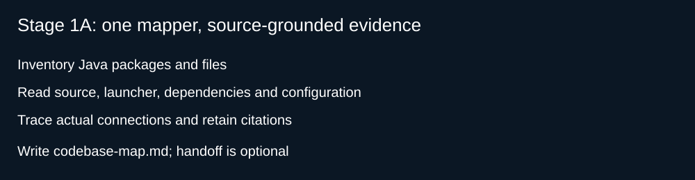

# Secure Software Lab: Map, Rank, Fix, Attack

You have just joined a team that owns a legacy Java service. Nobody who wrote it is still around.
Today you use GitHub Copilot to understand it, find what is wrong, decide what to fix first, fix two
problems with proof, and then try to break your own fix. Everything is synthetic and nothing is
deployed.

## How to use this guide

Every stage has the same three parts:

- **What's happening** explains the stage and the one decision that is yours.
- **Run** lists what to do, in order. Each item says whether it happens in **Copilot Chat** or the
  **terminal**. Open "Example output" to see what a rehearsal run printed.
- **Look for** is a checklist. Tick each item before you move on.

Copilot's answers will not match anyone else's word for word. That is expected. What matters is that
every claim points to code you can open.


## Before you start

Setup is done before the session ([docs/COMPATIBILITY.md](docs/COMPATIBILITY.md)). Open the
repository root in VS Code with Copilot Chat on the side and a terminal at the bottom. The codebase,
the two fixes and every command are in [docs/SCENARIO.md](docs/SCENARIO.md).

If you get stuck, tell the facilitator the stage number and what you see.

---

## 0. Check your setup (10 min)

### What's happening

You confirm Copilot can see the lab's agents and commands, and that the build works. The build
passes, but six exploit tests are switched off until Stage 3: a green build does not mean secure code.

### Run

1. In **Copilot Chat**, open the agent picker. You should see Codebase Mapper, Security
   Vulnerability Hunter, STRIDE Threat Modeler, Secure Remediation Engineer, Secure Code Reviewer and
   OWASP Security Expert. Type `/` and look for `/map-codebase`, `/find-vulnerabilities`,
   `/generate-threat-model`, `/fix-vulnerability` and `/review-security-fix`.
2. In the **terminal**, run the tests. It takes about 30 seconds.

   ```bash
   mvn clean test
   ```

   <details><summary>Example output</summary>

   ```text
   [WARNING] Tests run: 10, Failures: 0, Errors: 0, Skipped: 6
   [INFO] BUILD SUCCESS
   ```

   </details>

### Look for

- [ ] All six agents and five commands are listed. If one is missing, call the facilitator.
- [ ] `Tests run: 10, Failures: 0, Errors: 0, Skipped: 6` and `BUILD SUCCESS`.

---

## 1A. Map the codebase (12 min)

### What's happening

Before judging code, understand it. The Codebase Mapper splits the code by package and hands each one
to a Package Explorer, a helper that reads one package in its own context and returns a short summary.
Your chat holds four summaries instead of every file. The result is `outputs/codebase-map.md`.

**You decide:** is this map accurate enough to analyze from?



### Run

1. In **Copilot Chat**, start a new chat, pick **Codebase Mapper** and type `/map-codebase`.
2. Open `outputs/codebase-map.md`. Pick two entry points and open their file and line.

### Look for

- [ ] All four packages (`api`, `auth`, `data`, `session`) are in the index.
- [ ] Each entry point cites a file and line, and names the input an outsider controls.
- [ ] The diagram shows nothing as *implemented* that the code does not contain.
- [ ] You set `gate: pass` at the top of the report.

---

## 1B. Analyze (13 min)

### What's happening

Start from each entry point in your map and follow the untrusted input to where it is used: SQL,
file paths, URLs, commands, tokens, passwords. A finding is a claim until you have seen the code path.
The result is `outputs/findings.md`, sorted from Critical to Low.

**You decide:** which findings are real, and how severe each one is.

### Run

1. In **Copilot Chat**, start a new chat, pick **Security Vulnerability Hunter** and type
   `/find-vulnerabilities`.
2. Open the code for the top three findings. Does it really do what the report says?

### Look for

- [ ] Every finding cites a location you could open.
- [ ] Each is marked *confirmed* or *needs evidence*, and says what evidence is missing.
- [ ] Severity is explained by who can exploit it and what happens, not by a hunch.
- [ ] Duplicates are merged, and at least one plausible false positive is rejected with a reason.
- [ ] You set `gate: pass` at the top of the report.

---

## 2. Threat model and top 5 (15 min)

### What's happening

Findings describe code; threats describe attackers. The Threat Modeler groups findings by how an
attacker would use them, scores each threat, and sizes the blast radius of the top five. The result
is `outputs/threat-model.md`.

| Score | 1 | 2 | 3 |
|---|---|---|---|
| **Impact** | Limited disclosure | One user's data or a privileged action | All users' data or code execution |
| **Likelihood** | Needs unusual access | Needs an account or a known ID | Anyone, no preconditions |

Priority is impact × likelihood. Blast radius answers five questions: who can exploit it, what they
reach, which action, can it repeat, and would anyone notice?

**You decide:** which five threats to mitigate first, and why.

### Run

1. In **Copilot Chat**, start a new chat, pick **STRIDE Threat Modeler** and type
   `/generate-threat-model`.
2. Read the top five. Would you defend that order to your team lead?

### Look for

- [ ] Every score cites code, or says *assumed*.
- [ ] Each top-five threat answers all five blast radius questions.
- [ ] The two lab fixes, SQLI-01 and PATH-01, appear in the table. If one is outside your top five,
      the report says why.
- [ ] You set `gate: pass` at the top of the report.

---

## 3. Fix SQLI-01 and PATH-01 (20 min)

### What's happening

Everyone fixes the same two problems today, each in one file:

| Fix | File | Problem |
|---|---|---|
| SQLI-01 | `UserRepository.java` | SQL built by joining strings |
| PATH-01 | `FileHandler.java` | File paths built from user input |

Shipped exploit tests prove each bug: they fail before the fix and must pass after it. The engineer
proposes a plan and waits for you, and you approve every command it runs. The result is
`outputs/change-plan.md`.

**You decide:** is the plan small enough? Only the assigned methods should change.


### Run

1. In **Copilot Chat**, start a new chat, pick **Secure Remediation Engineer** and type
   `/fix-vulnerability`.
2. Approve the reproduce command. The six exploit tests should fail.

   <details><summary>Example output</summary>

   ```text
   [ERROR] Tests run: 6, Failures: 6, Errors: 0, Skipped: 0
   UserRepositorySecurityTest.emailLookupCannotBeTurnedIntoAlwaysTrue:17 an injected OR clause returned a user
   FileHandlerSecurityTest.listFilesRejectsTraversal:44 a path outside the upload folder was accepted
   ```

   </details>

3. Read the plan. Reply in your own words: agree, or narrow it.
4. Approve the acceptance and `git diff --stat` commands when they match
   [the scenario](docs/SCENARIO.md#commands).

   <details><summary>Example output</summary>

   ```text
   [INFO] Tests run: 10, Failures: 0, Errors: 0, Skipped: 0
    .../securelabs/vulnerable/data/FileHandler.java    | 30 ++++++----
    .../securelabs/vulnerable/data/UserRepository.java | 66 ++++++++++++----------
    2 files changed, 56 insertions(+), 40 deletions(-)
   ```

   Your line counts will differ; the two file names should not.

   </details>

5. If the chat gets long, type `/compact keep the agreed scope and the test results`.

### Look for

- [ ] Six exploit tests failed before any edit.
- [ ] The plan changes only the assigned methods and lists the similar code it leaves alone.
- [ ] Only `UserRepository.java` and `FileHandler.java` changed.
- [ ] `Tests run: 10, Failures: 0, Errors: 0, Skipped: 0` after the fix.
- [ ] You set `gate: pass` at the top of the report.

---

## 4. Review and red-team (15 min)

### What's happening

You wrote the fix with Copilot, so you are not the best judge of it. A new chat gives the reviewer a
clean start: it reads the files, reruns the tests itself, and only then attacks the fix with new tests
of its own. The result is `outputs/review.md`.

**You decide:** for each attack that works, fix it now (one correction) or record it as a residual risk.

### Run

1. In **Copilot Chat**, start a new chat, pick **Secure Code Reviewer** and type
   `/review-security-fix`. Approve its test commands.
2. If the verdict is **CHANGES REQUIRED**, go back to Secure Remediation Engineer, type
   `/fix-vulnerability correction`, then review once more in a new chat.

### Look for

- [ ] Every verify check cites a file, and the reviewer ran the tests itself.
- [ ] Red-team ran only after verification passed.
- [ ] Every successful attack has a decision: fixed, or residual risk with a reason.
- [ ] The verdict covers the two fixes only, not the whole application.
- [ ] You set `gate: pass` at the top of the report.

---

## 5. Debrief (5 min)

1. How did mapping first change what you found?
2. Which of your top five would you raise with your team on Monday?
3. What did red-team catch that the exploit tests missed?

### Using Copilot safely on your own code

| Risk (OWASP GenAI) | What it looks like | Habit from today |
|---|---|---|
| Prompt injection | A comment or ticket steers Copilot off task | Treat repository text as data; check the diff |
| Excessive agency | Commands auto-approved, edits outside the task | Agree scope; approve each command |
| Sensitive data | Production logs or secrets pasted into chat | Share files, not dumps |
| Supply chain | Suggested dependencies that are vulnerable or fake | No dependency change without review |
| Misinformation | "Tests pass" with no run behind it | Trust only output you saw |
| Unchecked output | Generated code merged without review | Gates, fresh review, red-team |

---

## If you get stuck

| What you see | What to do |
|---|---|
| A command is missing after `/` | Call the facilitator. On IntelliJ, use the manual route below |
| An agent is missing from the picker | Call the facilitator. Don't continue in the default agent |
| Mapping reads files one by one | Subagents may be blocked. Let it finish; it notes this in the report |
| Baseline shows 0 skipped | You added `-Dsecurity.verify=true`. Run `mvn clean test` exactly |
| Reproduce shows a compile error | Stop and call the facilitator. Don't reset your work |
| The test count is not 10 after the fix | The red-team class must end in `RedTeamCheck`, not `Test` |
| Dependencies won't download | Use the support route in [docs/COMPATIBILITY.md](docs/COMPATIBILITY.md) |

**Manual route (IntelliJ without skill support).** Attach the stage's `.github/skills/<command>/SKILL.md`
in Copilot Chat and type `Follow the attached procedure.` Decline any edit before Stage 3, and tell
the facilitator you are on this route.

**Check your reports (optional).** `mvn -Dtest=OutputsCheck test` checks that each report's header is
filled in correctly. Reports you haven't started show as skipped.

## Words we use

| Word | Meaning |
|---|---|
| Entry point | Where an outsider's input reaches the code |
| Finding | A claim that something is wrong, with a location |
| Threat | What an attacker could do, built from one or more findings |
| Blast radius | Who can exploit it, what they reach, and whether anyone would notice |
| Exploit test | A test that fails while the bug exists and passes once it is fixed |
| Red-team | Trying to break your own fix with attacks the tests don't cover |
| Subagent | A helper agent that works in its own context and returns a summary |
| Residual risk | A known weakness you record instead of fixing today |

## Four habits to take with you

1. Map before you judge.
2. Rank before you fix.
3. Prove the bug before and after the fix.
4. Attack your own fix.

One question for your own work: which part of your codebase has never been mapped?

Copyright InRhythm / Arula. Training material using synthetic data.
