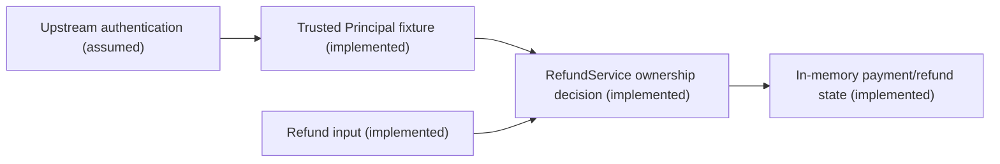

# Facilitator threat model

Finding REFUND-01. Threat T-REFUND-01. Asset is the payment owner's refund authorization and state.

The authenticated customer-2 crosses an object-authorization boundary when requesting a refund
for customer-1's payment. The missing owner comparison permits a state transition. Relevant
STRIDE categories include elevation of privilege and tampering. Financial impact is simulated
in this fixture, not an observed external settlement. The exploit needs an authenticated non-owner
and a known payment identifier. The mitigation checks owner equality before mutation. Tests
must show denial without consuming the legitimate owner's refund and preserve atomic handling.

No API gateway, external payment provider, database call, or production identity implementation
is evidenced by this scenario. Distributed atomicity and existence-disclosure policy remain open.
