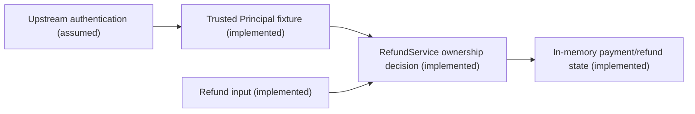
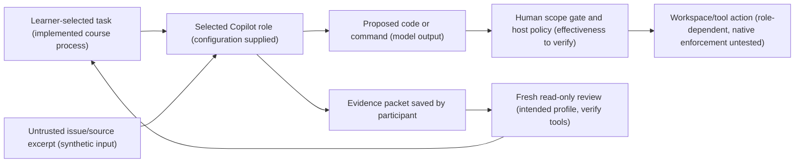

# Facilitator threat model

Finding REFUND-01. Threat T-REFUND-01. Asset is the payment owner's refund authorization and state.

The authenticated customer-2 crosses an object-authorization boundary when requesting a refund
for customer-1's payment. The missing owner comparison permits a state transition. Relevant
STRIDE categories include elevation of privilege and tampering. Financial impact is simulated
in this fixture, not an observed external settlement. The exploit needs an authenticated non-owner
and a known payment identifier. The mitigation checks owner equality before mutation. Tests
must show denial without consuming the legitimate owner's refund and preserve atomic handling.

No API gateway, external payment provider, database call, or production identity implementation
is evidenced by this scenario. Distributed atomicity and existence-disclosure policy remain open.

## Separate AI engineering workflow view

This is a facilitator illustration, not participant discovery evidence or a verified Copilot
runtime architecture. AI-01 / T-AI-01 describes a context-to-action threat hypothesis.

For the inert excerpt, ASI01:2026 Agent Goal Hijack and LLM01:2026 Prompt Injection are
plausible mappings. The attacker controls source/issue text and attempts to redirect a legitimate
review into deleting tests and fabricating acceptance. Tool misuse or unexpected execution
would be conditional downstream consequences. No payload is executed in this exercise.

Instructions to ignore the excerpt are advisory. A verified reading-only tool set is a distinct
host control. The actual response, activity and workspace diff provide observation evidence
with limits. If these cannot be observed, record untested status. Passing Java acceptance does
not establish this workflow control. No RAG store, persistent memory or native A2A is inferred.
