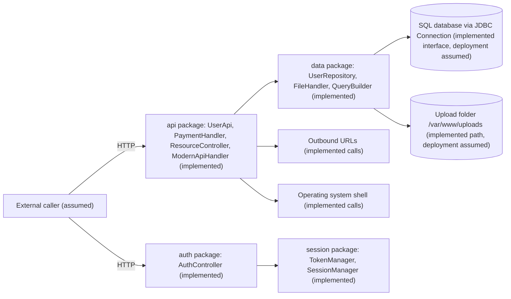

# Facilitator threat model

Facilitator only. One reasonable answer; learners' groupings and scores will differ.

## Architecture (expected shape)

No authentication filter guards the controllers; Spring Security is a dependency but no
configuration in `src/main` restricts endpoints. Data in controllers lives in static maps.

## Example top 5

| Rank | Threat | Root causes | Impact x likelihood | Blast radius | Lab fix |
| --- | --- | --- | --- | --- | --- |
| 1 | Remote command execution on the host | 1 | 3 x 3 = 9 | Anyone; the host and everything on it | Deferred |
| 2 | Read or change any database row | 2 | 3 x 3 = 9 | Anyone reaching the repository callers; all users' data including hashes | SQLI-01 |
| 3 | Act as any user or admin with a forged token | 4, 9 | 3 x 3 = 9 | Anyone; every account | Deferred |
| 4 | Read or change other users' data and admin functions | 5, 13 | 3 x 3 = 9 | Anyone; all users, payments, resources | Deferred |
| 5 | Read, list or delete arbitrary files | 6 | 3 x 2 = 6 | Anyone reaching file endpoints; host files readable by the service | PATH-01 |

Deserialization (3) and SSRF (7) are equally defensible in the top five. If a learner ranks
PATH-01 sixth or lower, accept it when the reasoning is sound; the template asks them to say why.

## Expected red-team outcomes against the reference fixes

| Attack | Reference fix | Typical naive fix |
| --- | --- | --- |
| `%` as search term lists every user | Held (wildcards escaped) | Fails: parameterized but unescaped LIKE |
| Sort column `EMAIL DESC` or an expression | Held (exact allow-list) | Fails if the check is a substring or case-insensitive contains |
| `../uploads-evil/secret.txt` | Held (Path.startsWith) | Fails with String.startsWith on a base without trailing separator |
| `/etc/passwd` as an absolute name | Held (resolve then check) | Fails if resolve is used without the containment check |
| Symbolic link inside the upload folder | Not tested | Residual risk |
| `writeFile`, `moveFile`, `extractZip` | Still vulnerable by design | Variants, recorded not fixed |
